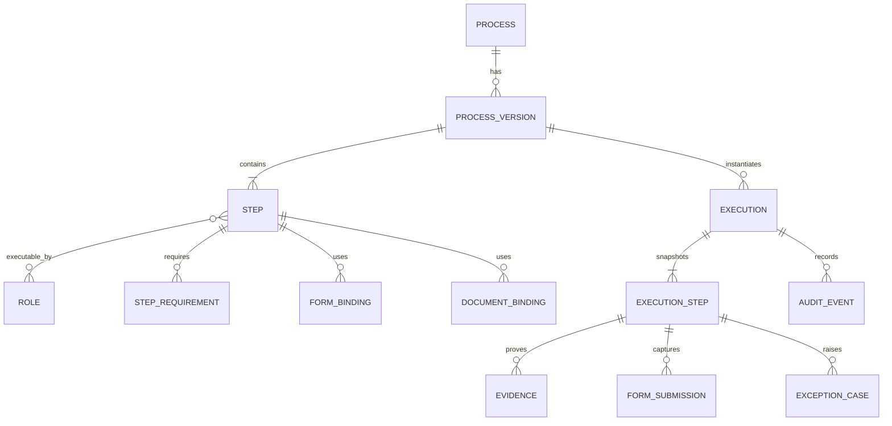

# Đặc tả triển khai hệ thống quản lý quy trình cho AI agent

**Loại tài liệu:** Product Requirements Document (PRD) + Software Requirements Specification (SRS) + hợp đồng triển khai cho AI agent  
**Phiên bản:** 1.4  
**Ngày:** 16/10/2026  
**Trạng thái:** Đường cơ sở kỹ thuật dự thảo  
**Nền tảng:** Web/PWA responsive cho desktop và mobile

## 1. Cách sử dụng tài liệu

Tài liệu này là nguồn yêu cầu hợp nhất để đội nghiệp vụ, kiến trúc sư, lập trình viên và AI coding agent cùng xây một hệ thống nhất quán. Khi có xung đột, áp dụng thứ tự ưu tiên:

1. Quyết định mới đã được chủ sản phẩm phê duyệt bằng văn bản.
2. Quy tắc nghiệp vụ và tiêu chí nghiệm thu trong tài liệu này.
3. Hợp đồng API, mô hình dữ liệu và máy trạng thái trong tài liệu này.
4. Mặc định kỹ thuật đề xuất.
5. Suy luận của người hoặc agent triển khai.

Agent **không được tự biến một quyết định còn mở thành yêu cầu chính thức**. Nếu cần để dựng prototype, agent dùng mặc định được ghi rõ, đặt cấu hình hoặc feature flag phù hợp, và ghi lại giả định trong pull request.

### 1.1 Nhãn quyết định

- **BASELINE:** đã thống nhất trong trao đổi; phải triển khai.
- **DEFAULT:** mặc định đề xuất để có thể bắt đầu; có thể đổi trước khi khóa thiết kế.
- **OPEN:** cần chủ sản phẩm quyết định; có thể chặn go-live.
- **DEFERRED:** ngoài MVP; không được tự đưa vào phạm vi.

### 1.2 Định nghĩa “hoàn thành” ở cấp tài liệu

Một yêu cầu chỉ hoàn thành khi có: mã nguồn, migration nếu có, kiểm thử tự động, kiểm soát quyền ở backend, xử lý lỗi, nhật ký cần thiết, tài liệu API và bằng chứng đáp ứng tiêu chí nghiệm thu. Giao diện chạy được nhưng thiếu quy tắc server-side hoặc truy vết **không được coi là hoàn thành**.

## 2. Mục tiêu sản phẩm và đường cơ sở

### 2.1 Kết quả cần đạt

Hệ thống cho phép doanh nghiệp quản lý **nhiều quy trình độc lập**, thay đổi chúng có kiểm soát theo phiên bản, áp dụng đúng phiên bản cho từng lượt công việc, thu giấy tờ/bằng chứng theo từng bước, xử lý ngoại lệ và truy vết ai làm gì vào thời điểm nào.

### 2.2 Các quyết định BASELINE

1. Giai đoạn 1 là **website responsive theo chuẩn PWA**, có giao diện hoàn chỉnh cho cả desktop và mobile. Desktop không chỉ dành cho quản trị mà phải hỗ trợ đầy đủ các nghiệp vụ phù hợp với quyền người dùng; mobile ưu tiên thao tác hiện trường.
2. Hệ thống hỗ trợ nhiều quy trình; mỗi quy trình có chủ sở hữu, phiên bản, bước, vai trò và giấy tờ riêng, đồng thời tái sử dụng danh mục dùng chung.
3. Trình soạn quy trình dùng **biểu mẫu + thêm bước + sắp xếp thứ tự**. Có màn hình xem trước dạng sơ đồ chỉ đọc.
4. Không xây BPMN designer kéo-thả, bộ máy luật động hoặc luồng song song phức tạp trong MVP.
5. Phiên bản đã phát hành là bất biến. Lượt đang chạy giữ nguyên phiên bản lúc khởi tạo; phiên bản mới chỉ áp dụng cho lượt mới.
6. Mọi chuyển trạng thái quan trọng phải ghi người dùng, thời gian máy chủ, lý do khi cần và nhật ký kiểm toán.
7. Bản chính thức có backend, cơ sở dữ liệu, tài khoản và phân quyền; không phải website tĩnh.
8. Điểm vào hệ thống là **trang giới thiệu công khai có nhận diện thương hiệu và khối đăng nhập nổi bật**. Sau khi xác thực, người dùng vào **trang chủ theo vai trò** rồi mới truy cập các mô-đun nghiệp vụ.
9. Xác thực MVP dùng **tài khoản nội bộ của hệ thống** với tên đăng nhập và mật khẩu. Không triển khai đăng nhập một lần (Single Sign-On — SSO) trong MVP.
10. Mọi màn hình cốt lõi phải có bố cục desktop chuyên biệt tại viewport từ 1024 px, không được chỉ phóng to giao diện mobile; danh sách, form, dashboard, trình soạn quy trình và báo cáo phải tận dụng không gian ngang hợp lý.
11. MVP **không triển khai xác thực hai lớp (2FA/MFA)**. Giao diện và API không hiển thị bước nhập mã OTP, đăng ký ứng dụng xác thực hoặc quản lý phương thức MFA.
12. Ảnh bằng chứng phải được nén trước khi tải lên theo cấu hình dung lượng; backend kiểm tra lại loại tệp, dung lượng và số lượng. Dữ liệu nghiệp vụ được lưu bền vững trong cơ sở dữ liệu; ảnh/tệp được lưu trong kho đối tượng và liên kết bằng metadata có kiểm soát quyền.
13. Mã nguồn được quản lý trên GitHub. Môi trường demo dùng Cloudflare Pages + Workers + D1 + R2 và tự động triển khai bằng GitHub Actions khi push vào nhánh demo đã chốt. Môi trường production chạy trên VPS bằng Docker Compose với ứng dụng, PostgreSQL và kho tệp tương thích S3. Ba môi trường dùng chung hợp đồng miền/API và không được fork logic nghiệp vụ.

### 2.3 Chỉ số thành công

- Người có quyền tạo và phát hành quy trình mới mà không sửa mã nguồn.
- Người thực hiện luôn thấy đúng bước, hướng dẫn và yêu cầu bằng chứng của phiên bản đã gắn.
- Không thể hoàn thành bước hoặc lượt nếu thiếu điều kiện bắt buộc.
- Có thể truy ngược từ báo cáo đến lượt thực hiện, bước, bằng chứng, ngoại lệ và người thao tác.
- Việc đổi quy trình không làm thay đổi hồ sơ lịch sử.

## 3. Phạm vi MVP và ranh giới

### 3.1 Trong phạm vi

- Trang giới thiệu công khai, đăng nhập/đăng xuất và trang chủ sau đăng nhập theo vai trò.
- Danh mục nhiều quy trình, nhóm quy trình và chủ sở hữu.
- Soạn quy trình theo biểu mẫu; thêm, sao chép, xóa và sắp xếp bước khi còn là bản nháp.
- Vai trò thực hiện, hướng dẫn, cảnh báo, biểu mẫu, giấy tờ, bằng chứng và điều kiện hoàn thành theo bước.
- Thẩm định, phê duyệt, lên lịch hiệu lực, phát hành, thay thế và ngừng dùng phiên bản.
- Tạo/giao lượt thực hiện; thao tác tuần tự; lưu nháp; tạm dừng; hoàn thành; hủy.
- Ghi nhận bước không đạt, ngoại lệ, làm lại và phê duyệt xử lý ngoại lệ.
- Ảnh/tệp bằng chứng, nén ảnh trước khi tải lên, giới hạn dung lượng/số lượng có cấu hình, biểu mẫu số, xác nhận người dùng và lịch sử.
- Lưu bền vững dữ liệu nghiệp vụ, metadata tệp và tệp bằng chứng; sao lưu và khôi phục theo yêu cầu vận hành.
- Tra cứu, bộ lọc, dashboard cơ bản, xuất CSV/XLSX và nhật ký kiểm toán.
- Thông báo trong ứng dụng.
- PWA online-first, phát hiện mất mạng và bảo toàn bản nháp cục bộ ở mức hợp lý.

### 3.2 Ngoài MVP

- BPMN 2.0 đầy đủ, canvas kéo-thả node, nhánh song song, timer event hoặc rule engine tổng quát.
- Offline sâu nhiều ngày và tự xử lý xung đột dữ liệu phức tạp.
- Ứng dụng iOS/Android native độc lập; phát hành App Store/Google Play.
- Zalo Mini App, Zalo OA, email tự động, SMS hoặc push native.
- Xác thực hai lớp (2FA/MFA), mã OTP hoặc ứng dụng xác thực.
- Tích hợp ERP, HRM, SSO, chữ ký số có chứng thư, OCR, AI thị giác hoặc tự động điều phối.
- Xóa vật lý hồ sơ vận hành, thay đổi lịch sử hoặc chỉnh sửa phiên bản đã phát hành.

Các mục ngoài MVP chỉ được triển khai qua change request có phân tích phạm vi, dữ liệu, bảo mật, lịch và chi phí.

## 4. Ngôn ngữ miền thống nhất

| Thuật ngữ | Nghĩa bắt buộc |
|---|---|
| Quy trình (`Process`) | Hồ sơ cấp cao mô tả một loại công việc lặp lại; không chứa trực tiếp lịch sử thực hiện. |
| Phiên bản (`ProcessVersion`) | Ảnh chụp bất biến của nội dung quy trình dùng để tạo lượt thực hiện. |
| Bước (`Step`) | Một hành động có thứ tự, vai trò, hướng dẫn và điều kiện hoàn thành. |
| Vai trò (`Role`) | Nhóm quyền/nghĩa vụ nghiệp vụ; không đồng nhất với một người cụ thể. |
| Mẫu biểu (`FormDefinition`) | Cấu trúc trường dữ liệu có phiên bản, quy tắc hợp lệ và quyền truy cập. |
| Mẫu tài liệu (`DocumentTemplate`) | Mẫu tệp hoặc tài liệu sinh tự động, có thể gắn với bước. |
| Bằng chứng (`Evidence`) | Ảnh, tệp, mã quét hoặc xác nhận chứng minh một hành động đã diễn ra. |
| Lượt thực hiện (`Execution`) | Một lần chạy thực tế của đúng một phiên bản quy trình. |
| Kết quả bước (`ExecutionStep`) | Trạng thái và dữ liệu thực tế của một bước trong một lượt. |
| Ngoại lệ (`ExceptionCase`) | Sai lệch khỏi đường chuẩn cần ghi nhận, xử lý và đóng. |
| Nhật ký kiểm toán (`AuditEvent`) | Bản ghi chỉ thêm về hành động quan trọng, chủ thể và thời gian máy chủ. |

Mã trong ngoặc là tên chuẩn khi đặt entity, API, event, biến hoặc test. Không dùng lẫn `workflow`, `job`, `task` nếu chưa ánh xạ rõ sang thuật ngữ trên.

## 5. Vai trò và mô hình quyền

Một người có thể mang nhiều vai trò. Quyền hiệu lực là tổng các quyền được cấp trong đúng phạm vi đơn vị/kho/bộ phận; backend luôn kiểm tra quyền, không tin dữ liệu ẩn trên giao diện.

Tách hai khái niệm: **vai trò hệ thống** cấp quyền thao tác (Admin, Soạn, Phê duyệt...) và **vai trò nghiệp vụ** được gắn vào bước (Thủ kho, Bảo vệ, Lái xe...). Không dùng một bảng role duy nhất nếu việc đó làm lẫn quyền quản trị với trách nhiệm nghiệp vụ.

| Khả năng | Admin | Chủ quy trình | Soạn | Thẩm định | Phê duyệt | Thực hiện | Giám sát | Xem |
|---|:---:|:---:|:---:|:---:|:---:|:---:|:---:|:---:|
| Quản lý tài khoản/quyền | ✓ |  |  |  |  |  |  |  |
| Tạo quy trình/phiên bản |  | ✓ | ✓ |  |  |  |  |  |
| Sửa bản nháp |  | ✓ | ✓ | góp ý |  |  |  |  |
| Gửi thẩm định |  | ✓ | ✓ |  |  |  |  |  |
| Xác nhận thẩm định |  | ✓ |  | ✓ |  |  |  |  |
| Phê duyệt/phát hành | cấu hình |  |  |  | ✓ |  |  |  |
| Tạo/nhận lượt thực hiện |  |  |  |  |  | ✓ | ✓ |  |
| Hoàn thành bước |  |  |  |  |  | ✓ | theo phân công |  |
| Bỏ qua/mở lại/hủy |  |  |  |  |  | theo quyền | ✓ |  |
| Xử lý ngoại lệ |  | ✓ |  |  | theo ngưỡng | theo quyền | ✓ |  |
| Xem/xuất báo cáo | theo phạm vi | ✓ |  | ✓ | ✓ | của mình | ✓ | ✓ |
| Xem audit log | ✓ | theo quy trình |  |  |  |  | theo quyền |  |

**OPEN-SOD-01:** chốt việc một người có được đồng thời là người soạn, thẩm định và phê duyệt cùng phiên bản hay không. Mặc định đề xuất: cấm tự phê duyệt phiên bản do chính mình soạn.

## 6. Bối cảnh nghiệp vụ và quan hệ miền



### 6.1 Bất biến miền

1. `Execution` luôn tham chiếu đúng một `ProcessVersion`; không được đổi sau khi tạo.
2. Nội dung phiên bản từ trạng thái `APPROVED` trở đi không được sửa. Sửa đổi phải tạo phiên bản nháp mới.
3. Khi tạo `Execution`, hệ thống sinh các `ExecutionStep` từ snapshot phiên bản. Thay đổi danh mục vai trò hoặc mẫu biểu về sau không làm đổi snapshot.
4. Mỗi bước có `sequence_no` duy nhất trong phiên bản và liên tục từ 1.
5. Bước bắt buộc chỉ hoàn thành khi tất cả `StepRequirement` bắt buộc hợp lệ.
6. Thao tác phát hành, bắt đầu, hoàn thành, bỏ qua, không đạt, mở lại, hủy và đóng ngoại lệ phải có `AuditEvent` cùng giao dịch.
7. Tệp bằng chứng đã được gắn vào hồ sơ hoàn thành không bị ghi đè; thay thế tạo bản ghi mới và quan hệ `supersedes`.
8. Thời gian nghiệp vụ dùng UTC trong cơ sở dữ liệu, hiển thị theo múi giờ cấu hình; dấu thời gian có giá trị kiểm toán lấy từ máy chủ.

## 7. Máy trạng thái bắt buộc

### 7.1 Phiên bản quy trình

```text
DRAFT -> IN_REVIEW -> APPROVED -----> ACTIVE -> SUPERSEDED -> RETIRED
   ^         |            |
   |---------|            +-> SCHEDULED -> ACTIVE
       trả sửa
```

`APPROVED` có thể kích hoạt ngay hoặc đi qua `SCHEDULED` khi ngày hiệu lực ở tương lai.

- `DRAFT`: được sửa cấu trúc.
- `IN_REVIEW`: khóa sửa; người thẩm định góp ý, chấp thuận hoặc trả sửa.
- `APPROVED`: đã đủ phê duyệt nhưng chưa có hiệu lực.
- `SCHEDULED`: có `effective_from` trong tương lai.
- `ACTIVE`: được phép tạo lượt mới.
- `SUPERSEDED`: đã có phiên bản mới thay thế; lượt cũ vẫn chạy.
- `RETIRED`: không dùng cho lượt mới.

Tại một thời điểm và một phạm vi áp dụng, mặc định chỉ có một phiên bản `ACTIVE`. Kích hoạt phiên bản mới phải chuyển phiên bản trước sang `SUPERSEDED` trong cùng giao dịch.

### 7.2 Lượt thực hiện

```text
CREATED -> IN_PROGRESS <-> PAUSED
   |            |            |
   +----------> CANCELLED <---+
                ^
IN_PROGRESS -> BLOCKED -> IN_PROGRESS
IN_PROGRESS -----------------> COMPLETED
```

- `COMPLETED` chỉ khi mọi bước bắt buộc đạt hoặc được bỏ qua hợp lệ và không còn ngoại lệ chặn.
- `CANCELLED` cần quyền và lý do; không thể tiếp tục.
- `PAUSED` là chủ động tạm dừng; `BLOCKED` là bị chặn bởi ngoại lệ hoặc điều kiện hệ thống.
- Mở lại lượt `COMPLETED` về `IN_PROGRESS` là quyền đặc biệt, tạo sự kiện `EXECUTION_REOPENED`, lý do và vòng revision mới; mặc định tắt.

### 7.3 Kết quả bước

```text
NOT_STARTED -> IN_PROGRESS -> PASSED
                    |          |
                    +-> FAILED +-> REOPENED -> IN_PROGRESS
                    +-> BLOCKED
NOT_STARTED/IN_PROGRESS -> SKIPPED (khi được phép)
```

`FAILED` phải tạo hoặc liên kết `ExceptionCase`. `SKIPPED` cần cấu hình cho phép, quyền, mã lý do và diễn giải. Bước sau chỉ được bắt đầu khi bước trước ở `PASSED` hoặc `SKIPPED`, trừ khi cấu hình quy trình cho phép thao tác trước nhưng vẫn chặn hoàn thành; MVP mặc định cưỡng chế tuần tự.

### 7.4 Ngoại lệ

```text
OPEN -> TRIAGED -> IN_REMEDIATION -> PENDING_APPROVAL -> RESOLVED -> CLOSED
  |          |              |
  +--------> REJECTED <------+-> REOPENED
```

Mỗi ngoại lệ phải có loại, mức nghiêm trọng, bước nguồn, người phát hiện, mô tả, chủ xử lý, hạn xử lý nếu có, cách khắc phục và kết quả. Ngoại lệ mức chặn giữ `Execution` ở `BLOCKED` cho đến khi quyết định hợp lệ cho phép tiếp tục, làm lại hoặc hủy.

## 8. Quy tắc nghiệp vụ chuẩn

| Mã | Quy tắc |
|---|---|
| BR-001 | Mã quy trình duy nhất trong toàn hệ thống; số phiên bản duy nhất trong một quy trình. |
| BR-002 | Không xóa vật lý quy trình/phiên bản/lượt đã phát sinh lịch sử. |
| BR-003 | Nội dung thay đổi phải có `change_summary`; thay đổi lớn cần đánh giá tác động. |
| BR-004 | Phiên bản mới không tự di chuyển lượt đang chạy từ phiên bản cũ. |
| BR-005 | Tất cả kiểm tra quyền và điều kiện hoàn thành chạy lại ở backend. |
| BR-006 | Không chấp nhận thời gian do thiết bị gửi làm dấu thời gian kiểm toán. |
| BR-007 | Bằng chứng hướng dẫn và bằng chứng thực tế là hai loại tách biệt. |
| BR-008 | Mọi thao tác idempotent quan trọng không được tạo kết quả trùng khi client retry. |
| BR-009 | Dữ liệu chưa được server xác nhận phải hiển thị rõ “chưa đồng bộ”. |
| BR-010 | KPI chỉ tính từ bản ghi đủ điều kiện; định nghĩa mẫu số phải hiển thị cùng báo cáo. |

## 9. Yêu cầu chức năng có thể kiểm thử

Mức ưu tiên: **MUST** bắt buộc MVP; **SHOULD** thực hiện nếu không thay đổi đường cơ sở; **COULD** chỉ khi được chọn; **DEFERRED** không triển khai.

### 9.1 Danh mục và thiết kế quy trình

| Mã | Pri | Hành vi bắt buộc |
|---|---|---|
| PRC-001 | MUST | Tạo quy trình và bản nháp đầu với mã, tên, mục đích, phạm vi, đối tượng áp dụng, điều kiện bắt đầu/kết thúc, chủ sở hữu, đơn vị áp dụng và tác nhân kích hoạt xem xét. |
| PRC-002 | MUST | Tìm kiếm/lọc theo mã, tên, nhóm, chủ sở hữu, trạng thái và đơn vị. |
| PRC-003 | MUST | Tạo phiên bản đầu hoặc phiên bản kế tiếp bằng cách sao chép bản gần nhất. |
| PRC-004 | MUST | Thêm/sửa/xóa/sao chép bước trong bản nháp; sắp xếp bằng kéo lên/xuống hoặc drag reorder danh sách. |
| PRC-005 | MUST | Mỗi bước có mã, tiêu đề hành động, điều kiện tiên quyết, đầu vào, hướng dẫn, kết quả mong đợi, đầu ra/bàn giao, ghi chú, vai trò, cờ bắt buộc, thời lượng mục tiêu và cảnh báo. |
| PRC-006 | MUST | Cấu hình yêu cầu hoàn thành: trường dữ liệu, biểu mẫu, ảnh/tệp, xác nhận, mã quét hoặc ghi chú. |
| PRC-007 | MUST | Cấu hình cho phép bỏ qua, người được bỏ qua, lý do bắt buộc và mức phê duyệt. |
| PRC-008 | MUST | Cấu hình hướng xử lý khi không đạt: dừng, làm lại, chuyển giám sát hoặc hủy. Không phải graph tùy ý. |
| PRC-009 | MUST | Kiểm tra bản nháp trước khi gửi duyệt và trả danh sách lỗi theo bước/trường. |
| PRC-010 | SHOULD | Xem trước giao diện điện thoại và sơ đồ tuyến tính chỉ đọc. |
| PRC-011 | SHOULD | Thư viện bước/mẫu biểu dùng chung; sao chép vào phiên bản phải tạo snapshot. |
| PRC-012 | DEFERRED | Canvas BPMN kéo-thả và nhánh song song tùy ý. |

**Điều kiện hợp lệ tối thiểu trước khi gửi duyệt:** có chủ sở hữu; có ít nhất một bước; thứ tự liên tục; mỗi bước có tiêu đề và ít nhất một vai trò; mọi mẫu biểu/tài liệu tham chiếu có phiên bản khả dụng; quy tắc bỏ qua và không đạt không mâu thuẫn; có tóm tắt thay đổi.

### 9.2 Thẩm định, phê duyệt và phát hành

| Mã | Pri | Hành vi bắt buộc |
|---|---|---|
| GOV-001 | MUST | Gửi bản nháp thẩm định và khóa sửa nội dung. |
| GOV-002 | MUST | Người thẩm định ghi nhận góp ý theo toàn phiên bản hoặc từng bước. |
| GOV-003 | MUST | Trả sửa đưa bản về `DRAFT`, giữ toàn bộ lịch sử góp ý. |
| GOV-004 | MUST | Phê duyệt lưu người, thời gian, vai trò và quyết định; không cho tự phê duyệt theo mặc định. |
| GOV-005 | MUST | Phát hành ngay hoặc đặt `effective_from`; chỉ phiên bản đủ phê duyệt mới được phát hành. |
| GOV-006 | MUST | Kích hoạt bản mới tự thay thế bản đang hiệu lực trong cùng phạm vi. |
| GOV-007 | MUST | Ngừng dùng không làm mất khả năng tra cứu hoặc tiếp tục lượt cũ. |
| GOV-008 | SHOULD | Cấu hình ngày xem xét tiếp theo và nhắc trước hạn trong ứng dụng. |
| GOV-009 | SHOULD | Phân loại thay đổi nhỏ/lớn; thay đổi lớn yêu cầu đánh giá tác động và dry run. |

### 9.3 Khởi tạo và thực hiện công việc

| Mã | Pri | Hành vi bắt buộc |
|---|---|---|
| EXE-001 | MUST | Chỉ hiển thị phiên bản đang hiệu lực trong phạm vi người dùng khi tạo lượt mới. |
| EXE-002 | MUST | Tạo mã lượt duy nhất, snapshot bước/yêu cầu/vai trò và ghi người tạo + thời gian máy chủ. |
| EXE-003 | MUST | Hỗ trợ giao cho người hoặc nhóm vai trò; người ngoài phạm vi không xem hoặc nhận việc. |
| EXE-004 | MUST | Hiển thị tên, mã, tiến độ, bước hiện tại, hạn xử lý và trạng thái đồng bộ trên mọi màn hình bước. |
| EXE-005 | MUST | Bắt đầu/lưu nháp/hoàn thành từng bước; tiếp tục trên thiết bị khác sau khi server xác nhận. |
| EXE-006 | MUST | Chặn bước sau khi bước trước chưa đạt theo chế độ tuần tự. |
| EXE-007 | MUST | Chặn hoàn thành bước khi thiếu yêu cầu bắt buộc và trả lỗi theo từng yêu cầu. |
| EXE-008 | MUST | Tạm dừng, tiếp tục và hủy theo quyền; hủy bắt buộc có lý do. |
| EXE-009 | MUST | Chỉ hoàn thành lượt khi mọi bước bắt buộc hợp lệ và không còn ngoại lệ chặn. |
| EXE-010 | SHOULD | Giao lại công việc có lý do và audit; không đổi người đã thực hiện bước cũ. |

### 9.4 Biểu mẫu, giấy tờ và bằng chứng

| Mã | Pri | Hành vi bắt buộc |
|---|---|---|
| EVD-001 | MUST | Bước hỗ trợ nhiều loại yêu cầu: ảnh, tệp, văn bản, số, ngày, lựa chọn, checkbox, mã quét và xác nhận. |
| EVD-002 | MUST | Form definition có phiên bản; submission lưu schema version và giá trị đã nộp. |
| EVD-003 | MUST | Ảnh hướng dẫn chỉ đọc, hiển thị tách khỏi ảnh thực tế. |
| EVD-004 | MUST | Tệp thực tế lưu tên gốc, MIME do server phát hiện, dung lượng, checksum, người tải và thời gian. |
| EVD-005 | MUST | Quét malware hoặc cách ly tệp đến khi kiểm tra xong; không phục vụ tệp bằng URL công khai vĩnh viễn. |
| EVD-006 | MUST | Xác nhận điện tử cơ bản là danh tính đăng nhập + hành động + thời gian; không được gọi là chữ ký số pháp lý. |
| EVD-007 | MUST | Không nhập lại dữ liệu chung nếu có thể tham chiếu từ `Execution`; tài liệu sinh phải ghi nguồn trường. |
| EVD-008 | MUST | Nén ảnh phía client trước khi tải lên, không phóng lớn ảnh nhỏ, giữ khả năng đọc/chứng minh; hiển thị dung lượng trước/sau, tiến độ, lỗi và retry có kiểm soát. |
| EVD-009 | MUST | Áp dụng giới hạn có cấu hình ở cả client và server. DEFAULT: ảnh nguồn tối đa 15 MB; ảnh sau nén mục tiêu tối đa 2 MB, cạnh dài tối đa 1.920 px, chất lượng 82%; tối đa 10 ảnh/yêu cầu; tệp không phải ảnh tối đa 25 MB; tổng tệp một bước tối đa 100 MB. Server là nơi quyết định cuối cùng. |
| EVD-010 | MUST | Chỉ gắn bằng chứng vào bước sau khi server xác minh upload hoàn tất, checksum, MIME, dung lượng và trạng thái quét. Metadata lưu trong cơ sở dữ liệu, nội dung tệp lưu ở kho đối tượng riêng tư; thất bại giữa chừng không được tạo bằng chứng hợp lệ. |

### 9.5 Ngoại lệ và làm lại

| Mã | Pri | Hành vi bắt buộc |
|---|---|---|
| EXP-001 | MUST | Chọn “Không đạt” tạo ngoại lệ gắn đúng bước và snapshot dữ liệu tại thời điểm phát hiện. |
| EXP-002 | MUST | Mức độ: `LOW`, `MEDIUM`, `HIGH`, `BLOCKING`; chỉ `BLOCKING` tự động chặn lượt theo mặc định. |
| EXP-003 | MUST | Giám sát chọn một kết quả: làm lại bước, cho tiếp tục có điều kiện, hủy lượt hoặc chuyển cấp. |
| EXP-004 | MUST | Làm lại tạo attempt mới; attempt cũ giữ nguyên và vẫn xem được. |
| EXP-005 | MUST | Đóng ngoại lệ cần mô tả khắc phục và bằng chứng nếu quy tắc yêu cầu. |
| EXP-006 | SHOULD | Thống kê ngoại lệ theo quy trình, phiên bản, bước, loại, mức độ, đơn vị và thời gian xử lý. |

### 9.6 Giám sát, KPI và xuất dữ liệu

| Mã | Pri | Hành vi bắt buộc |
|---|---|---|
| RPT-001 | MUST | Lọc lượt theo mã, quy trình, phiên bản, trạng thái, khoảng ngày, người/đơn vị và ngoại lệ. |
| RPT-002 | MUST | Timeline chi tiết hiển thị bước, attempt, người thao tác, thời gian, biểu mẫu, bằng chứng và ngoại lệ theo quyền. |
| RPT-003 | MUST | Xuất dữ liệu tuân theo cùng bộ lọc và quyền cột như màn hình. |
| RPT-004 | SHOULD | Dashboard: số lượt theo trạng thái, tỷ lệ hoàn thành, đúng hạn, đủ bằng chứng, right-first-time và thời gian chu kỳ. |
| RPT-005 | SHOULD | Cho phép drill-down từ KPI đến tập lượt tạo nên tử số/mẫu số. |
| RPT-006 | MUST | Hiển thị định nghĩa, thời gian dữ liệu và bộ lọc cùng KPI; không dùng số không truy nguyên được. |

Công thức chuẩn:

- `completion_rate = completed_required_steps / total_required_steps`.
- `on_time_rate = executions_completed_on_or_before_due / completed_executions_with_due_date`.
- `evidence_completeness = satisfied_required_evidence / required_evidence`.
- `right_first_time = executions_without_rework_or_blocking_exception / eligible_completed_executions`.
- `cycle_time = completed_at - started_at`; báo cáo median và P95, không chỉ trung bình.

### 9.7 Quản trị và kiểm toán

| Mã | Pri | Hành vi bắt buộc |
|---|---|---|
| ADM-001 | MUST | Tạo, khóa/mở tài khoản; gán vai trò và phạm vi; không xóa lịch sử của tài khoản đã thao tác. |
| ADM-002 | MUST | Audit log chỉ thêm, có actor, action, object, request/correlation ID, thời gian và thay đổi quan trọng. |
| ADM-003 | MUST | Không ghi mật khẩu, token, nội dung tệp hoặc dữ liệu nhạy cảm không cần thiết vào log. |
| ADM-004 | MUST | Tra cứu audit theo thời gian, actor, action và object; quyền xem được giới hạn. |
| ADM-005 | SHOULD | Danh mục lý do hủy/bỏ qua/không đạt có mã, trạng thái và hiệu lực. |
| ADM-006 | SHOULD | Danh mục đơn vị, địa điểm, vai trò và nhóm quy trình dùng chung. |

### 9.8 Trang giới thiệu, xác thực và trang chủ

| Mã | Pri | Hành vi bắt buộc |
|---|---|---|
| ONB-001 | MUST | Người chưa đăng nhập thấy trang giới thiệu công khai gồm nhận diện thương hiệu, thông điệp giá trị ngắn, 3–4 năng lực chính, minh họa sản phẩm và khối đăng nhập nổi bật ngay trong vùng nhìn đầu tiên trên desktop. |
| ONB-002 | MUST | Trên mobile, nội dung giới thiệu được rút gọn; nút hoặc khối đăng nhập xuất hiện trước khi người dùng phải cuộn sâu. Không để hiệu ứng trang trí cản trở đăng nhập. |
| ONB-003 | MUST | Khối đăng nhập nội bộ có trường tên đăng nhập, mật khẩu, nút hiển thị/ẩn mật khẩu, trạng thái loading và lỗi chung không tiết lộ tài khoản có tồn tại hay không. Liên kết khôi phục mật khẩu chỉ hiển thị khi chức năng này được bật theo `OPEN-AUTH-POLICY-01`. |
| ONB-004 | MUST | Đăng nhập thành công chuyển đến trang chủ theo vai trò; người không có phiên hợp lệ không truy cập được route nghiệp vụ và được đưa về trang đăng nhập an toàn. |
| ONB-005 | MUST | Trang chủ sau đăng nhập chào người dùng, hiển thị việc cần làm, lượt đang thực hiện, ngoại lệ/chờ duyệt theo quyền và lối tắt đến hành động thường dùng. Không hiển thị thẻ hoặc số liệu người dùng không có quyền xem. |
| ONB-006 | MUST | Đăng xuất hủy phiên phía server, xóa trạng thái nhạy cảm phía client và đưa người dùng về trang giới thiệu. |
| ONB-007 | SHOULD | Dashboard quản trị trên trang chủ hiển thị KPI tổng quan và drill-down theo `RPT-004–005`; người thực hiện ưu tiên danh sách “Việc của tôi” thay vì KPI quản trị. |
| ONB-008 | SHOULD | Nội dung giới thiệu, logo, màu thương hiệu, ảnh minh họa và thông tin hỗ trợ được cấu hình mà không sửa code; thay đổi nội dung phải qua quyền quản trị. |
| ONB-009 | MUST | Trang giới thiệu và đăng nhập có thiết kế thống nhất, responsive, tương phản đạt yêu cầu, focus rõ, thao tác bàn phím đầy đủ và không phụ thuộc ảnh nền để truyền đạt thông tin chính. |
| ONB-010 | MUST | Tất cả màn hình cốt lõi có bố cục desktop tại viewport từ 1024 px: điều hướng cố định hoặc thu gọn được, vùng nội dung có chiều rộng hợp lý, bảng/danh sách không bị biến thành chuỗi card mobile khi còn đủ không gian và hành động chính luôn dễ thấy. |
| ONB-011 | MUST | Chức năng và quyền trên desktop tương đương mobile, trừ tính năng phụ thuộc thiết bị được ghi rõ. Người dùng có thể đăng nhập, xem trang chủ, quản lý quy trình, thực hiện công việc, tải/chụp ảnh hoặc chọn tệp, xử lý ngoại lệ, xem báo cáo và quản trị theo quyền trên desktop. |

## 10. Hợp đồng trải nghiệm người dùng

### 10.1 Hành trình vào hệ thống

Hành trình chuẩn là: **Trang giới thiệu → Đăng nhập → Trang chủ theo vai trò → Mô-đun nghiệp vụ**. Không đưa người dùng chưa đăng nhập thẳng vào dashboard trống hoặc một biểu mẫu đăng nhập rời rạc thiếu bối cảnh sản phẩm.

### 10.2 Trang giới thiệu và đăng nhập

Desktop dùng bố cục hai vùng trong vùng nhìn đầu tiên: vùng giới thiệu chiếm ưu thế về thị giác và vùng đăng nhập dạng card nổi bật, dễ nhận biết. Trang cần tạo cảm giác sản phẩm hoàn chỉnh và đáng tin cậy nhưng không hy sinh tốc độ hay khả năng sử dụng.

Vùng giới thiệu gồm:

- Logo/tên hệ thống, thông điệp giá trị một câu và mô tả ngắn.
- Minh họa trực quan liên quan đến quy trình, checklist, bằng chứng và truy vết; không dùng hình trang trí không liên quan.
- Tối đa 3–4 điểm nổi bật: đa quy trình, kiểm soát phiên bản, thực hiện trên mobile và báo cáo truy vết.
- Thông tin hỗ trợ hoặc liên hệ chỉ khi đã được doanh nghiệp cung cấp.

Khối đăng nhập gồm tiêu đề rõ, trường tên đăng nhập, trường mật khẩu, nút hiển thị/ẩn mật khẩu, tùy chọn ghi nhớ phù hợp chính sách, liên kết khôi phục khi được bật và nút đăng nhập là hành động chính. Không hiển thị nút SSO trong MVP. Không đặt carousel, video tự chạy hoặc hiệu ứng nặng trước hành động đăng nhập.

Trên mobile, dùng một cột: nhận diện và thông điệp ngắn ở trên, card đăng nhập ngay sau đó; các điểm giới thiệu chi tiết nằm dưới. Bàn phím ảo không được che nút đăng nhập hoặc thông báo lỗi.

Định hướng thị giác: hệ màu thương hiệu có tương phản cao, khoảng trắng thoáng, card có phân cấp rõ, typography nhất quán, chuyển động ngắn và có hỗ trợ `prefers-reduced-motion`. “Đẹp” phải được nghiệm thu bằng prototype được duyệt và các tiêu chí về nhất quán, responsive, tương phản, tốc độ; không chỉ dựa trên cảm nhận của lập trình viên.

### 10.3 Trang chủ sau đăng nhập

Trang chủ thay đổi theo quyền và công việc:

- **Người thực hiện:** việc được giao, lượt đang làm, việc sắp đến hạn, trạng thái chờ đồng bộ và nút tiếp tục công việc gần nhất.
- **Người duyệt/giám sát:** quy trình chờ duyệt, ngoại lệ cần xử lý, lượt bị chặn và cảnh báo quá hạn.
- **Chủ quy trình/Admin:** KPI tổng quan, phiên bản sắp đến ngày xem xét, shortcut tạo quy trình/lượt và cảnh báo vận hành theo quyền.

Mọi vai trò đều có header với tên hệ thống, điều hướng, thông báo trong ứng dụng, hồ sơ cá nhân và đăng xuất. Empty state phải hướng dẫn hành động tiếp theo; không dựng số liệu mẫu như dữ liệu thật.

### 10.4 Giao diện desktop

Từ viewport 1024 px, hệ thống dùng bố cục desktop thực thụ thay vì kéo giãn màn hình điện thoại. Khung ứng dụng có thanh điều hướng bên trái có thể thu gọn, header chứa tìm kiếm hoặc ngữ cảnh trang, thông báo, hồ sơ và đăng xuất; vùng nội dung ưu tiên chiều rộng cho bảng, bộ lọc và thao tác nhiều cột.

- Dashboard dùng lưới responsive 12 cột; KPI, cảnh báo và danh sách công việc có thứ bậc rõ, không dàn đều thành các ô giống nhau.
- Danh sách dữ liệu dùng bảng có sắp xếp, lọc, phân trang, chọn cột và hành động theo dòng khi phù hợp; bộ lọc nâng cao có thể mở ở panel bên phải hoặc vùng trên bảng.
- Form dài chia thành section hoặc tab có nhãn, hiển thị lỗi theo section và có thanh hành động bám cạnh hoặc cuối màn hình; không tạo form hai cột nếu thứ tự đọc trở nên mơ hồ.
- Màn hình chi tiết ưu tiên bố cục master–detail hoặc nội dung chính + panel ngữ cảnh. Lịch sử, bằng chứng và audit có thể xem đồng thời với thông tin chính mà không phải đổi qua nhiều trang.
- Mọi thao tác cốt lõi dùng được bằng bàn phím; trạng thái hover không phải cách duy nhất để lộ hành động. Breakpoint phải được kiểm thử ở 1024, 1280, 1440 và 1920 px.
- Tính năng chụp ảnh dùng camera khi trình duyệt/thiết bị hỗ trợ; desktop luôn có phương án chọn tệp tương đương.

### 10.5 Cấu trúc điều hướng

- **Trang chủ:** tổng quan theo vai trò và hành động ưu tiên.
- **Công việc:** Việc của tôi, Tạo lượt, Theo dõi, Ngoại lệ.
- **Quy trình:** Danh mục, Bản nháp, Chờ duyệt, Đang hiệu lực, Sắp xem xét.
- **Biểu mẫu & tài liệu:** Mẫu biểu, mẫu tài liệu, thư viện hướng dẫn.
- **Báo cáo:** Tổng quan, tuân thủ, thời gian chu kỳ, ngoại lệ.
- **Quản trị:** Người dùng, vai trò, phạm vi, danh mục, audit.

### 10.6 Trình soạn quy trình

Bố cục desktop gồm panel thông tin phiên bản, danh sách bước và panel chi tiết bước. Mobile chỉ hỗ trợ chỉnh sửa đơn giản; việc thiết kế quy trình tối ưu trên desktop. Reorder danh sách phải có cả kéo-thả và nút lên/xuống để hỗ trợ truy cập bàn phím.

Mỗi bước hiển thị tóm tắt: số thứ tự, tiêu đề, vai trò, số yêu cầu bắt buộc, thời lượng và cảnh báo lỗi cấu hình. Xem trước sơ đồ dùng các node tuyến tính; click node mở chi tiết nhưng không chỉnh sửa trên sơ đồ.

### 10.7 Màn hình thực hiện

Một màn hình chỉ có một hành động chính. Luôn hiển thị tiến độ, bước hiện tại, hướng dẫn, ảnh mẫu, yêu cầu còn thiếu và trạng thái đồng bộ. Nút bỏ qua/hủy tách khỏi nút hoàn thành và có xác nhận. Lỗi nêu đúng trường thiếu và cách khắc phục; màu không phải tín hiệu duy nhất.

### 10.8 Chụp, nén và tải ảnh

Sau khi chụp hoặc chọn ảnh, client đọc kích thước và dung lượng, xoay đúng hướng, nén theo cấu hình `EVD-009`, rồi hiển thị thumbnail cùng dung lượng sau nén trước khi tải lên. Không phóng lớn ảnh nhỏ. Nếu ảnh vẫn vượt giới hạn sau nén, giao diện yêu cầu người dùng chụp/chọn lại hoặc giảm kích thước; không tự bỏ ảnh.

Ảnh đã nhỏ hơn ngưỡng không cần nén lại gây giảm chất lượng. Ảnh chính thức là bản đã tải lên và được server xác minh; bản tạm trên thiết bị không phải nguồn sự thật. Mặc định chỉ lưu bản tối ưu. Chỉ giữ bản gốc khi yêu cầu bằng chứng bật `retain_original=true`; khi đó bản gốc chịu giới hạn riêng và cùng chính sách quyền/lưu trữ.

## 11. Mô hình dữ liệu logic

Mọi bảng nghiệp vụ có `id` dạng UUID, `created_at`, `created_by`; bảng có thể sửa thêm `updated_at`, `updated_by` và trường version để khóa lạc quan. Tên dưới đây là hợp đồng logic; migration cụ thể phải giữ ý nghĩa và ràng buộc.

| Entity | Trường cốt lõi | Ràng buộc chính |
|---|---|---|
| `User` | `username`, `display_name`, `email`, `status`, `password_changed_at`, `failed_login_count`, `locked_until` | `username` chuẩn hóa và unique; không xóa nếu đã có lịch sử |
| `LocalCredential` | `user_id`, `password_hash`, `hash_algorithm`, `hash_params`, `must_change_password`, `rotated_at` | một credential hiện hành/user; chỉ lưu hash, không lưu mật khẩu |
| `UserSession` | `user_id`, `session_hash`, `created_at`, `last_seen_at`, `expires_at`, `revoked_at`, `device_summary` | token phía server được hash; thu hồi được từng phiên hoặc toàn bộ |
| `PasswordResetRequest` | `user_id`, `token_hash`, `expires_at`, `used_at` | token một lần, thời hạn ngắn; không tiết lộ user tồn tại |
| `Process` | `code`, `owner_user_id`, `group_id`, `org_scope_id`, `status` | `code` unique; chỉ là container định danh |
| `ProcessVersion` | `process_id`, `version_no`, `name`, `purpose`, `scope_text`, `audience`, `trigger_text`, `finish_condition`, `review_triggers_json`, `status`, `change_summary`, `effective_from`, `effective_to`, `review_due_at` | unique `(process_id, version_no)`; bất biến sau duyệt |
| `Step` | `version_id`, `step_code`, `sequence_no`, `title`, `prerequisite_text`, `input_text`, `instruction`, `expected_result`, `output_text`, `is_required`, `target_duration_sec`, `failure_policy` | unique thứ tự/mã trong version |
| `BusinessRole` | `code`, `name`, `description`, `status` | `code` unique; tách khỏi quyền hệ thống |
| `UserBusinessRole` | `user_id`, `business_role_id`, `org_scope_id`, `effective_from`, `effective_to` | không trùng phân công đang hiệu lực |
| `StepRole` | `step_id`, `business_role_id`, `responsibility_type` | unique bộ ba phù hợp |
| `StepRequirement` | `step_id`, `type`, `label`, `is_required`, `min_count`, `max_count`, `validation_json` | schema kiểm tra theo `type`; giới hạn ảnh/tệp snapshot theo phiên bản |
| `FormDefinition` | `code`, `name`, `version_no`, `schema_json`, `status` | phiên bản đã dùng bất biến |
| `FormBinding` | `step_id`, `form_definition_id`, `mode`, `is_required` | snapshot/reference có version |
| `DocumentTemplate` | `code`, `name`, `version_no`, `template_object_key`, `mapping_json` | không URL công khai |
| `Execution` | `execution_no`, `process_version_id`, `status`, `org_scope_id`, `assignee_id`, `started_at`, `due_at`, `completed_at` | version không đổi; `execution_no` unique |
| `ExecutionStep` | `execution_id`, `source_step_id`, `sequence_no`, `snapshot_json`, `status`, `current_attempt_no` | unique `(execution, sequence)` |
| `StepAttempt` | `execution_step_id`, `attempt_no`, `status`, `started_at`, `completed_at`, `performed_by` | unique `(step, attempt_no)` |
| `FormSubmission` | `attempt_id`, `form_definition_id`, `schema_version`, `data_json`, `submitted_at` | validation server-side |
| `StoredObject` | `object_key`, `storage_class`, `original_name`, `detected_mime`, `size_bytes`, `sha256`, `width_px`, `height_px`, `scan_status`, `verified_at`, `deleted_at` | object riêng tư; unique `object_key`; không coi upload chưa xác minh là hợp lệ |
| `Evidence` | `attempt_id`, `requirement_id`, `type`, `stored_object_id`, `captured_at`, `uploaded_by`, `compression_json`, `supersedes_id` | append-only sau submit; tham chiếu `StoredObject` đã xác minh |
| `ExceptionCase` | `execution_step_id`, `attempt_id`, `severity`, `type_code`, `status`, `description`, `owner_id`, `due_at`, `resolution` | đóng cần resolution |
| `ApprovalDecision` | `version_id`, `stage`, `decision`, `actor_id`, `comment`, `decided_at` | append-only |
| `AuditEvent` | `event_type`, `actor_id`, `object_type`, `object_id`, `occurred_at`, `request_id`, `diff_json` | append-only, indexed |

### 11.1 Snapshot và dữ liệu JSON

`ExecutionStep.snapshot_json` chỉ chứa dữ liệu cần tái hiện bước: mã/tiêu đề/hướng dẫn, vai trò, yêu cầu, form/document version, cảnh báo và chính sách không đạt. Không dùng snapshot để né chuẩn hóa toàn bộ mô hình.

`validation_json`, `schema_json` và `mapping_json` phải có JSON Schema hoặc schema nội bộ được version hóa, kiểm tra ở biên API, có migration strategy và test fixture. Không lưu mã thực thi tùy ý trong JSON.

### 11.2 Chỉ mục tối thiểu

- `Process(code)`, `Process(status, org_scope_id)`.
- `ProcessVersion(process_id, status, effective_from)`.
- `Execution(execution_no)`, `(org_scope_id, status, created_at)`, `(assignee_id, status)`.
- `ExecutionStep(execution_id, sequence_no)`.
- `ExceptionCase(status, severity, owner_id, due_at)`.
- `AuditEvent(object_type, object_id, occurred_at)` và `(actor_id, occurred_at)`.
- `StoredObject(sha256)`, `(scan_status, verified_at)` và chỉ mục phục vụ dọn upload mồ côi.

### 11.3 Lưu trữ bền vững và nguồn sự thật

- Ở production, PostgreSQL là nguồn sự thật cho tài khoản, quy trình, phiên bản, lượt thực hiện, kết quả bước, biểu mẫu, metadata bằng chứng, ngoại lệ và audit.
- Ở demo Cloudflare, D1 là nguồn sự thật của riêng môi trường demo. D1 dùng SQLite và không được giả định tương đương PostgreSQL về kiểu dữ liệu, khóa, transaction, JSON, thời gian hoặc truy vấn đồng thời; repository adapter và test contract phải giữ cùng bất biến miền.
- Kho đối tượng riêng tư là nguồn sự thật cho ảnh/tệp: R2 ở demo; kho tương thích S3 ở production. Cơ sở dữ liệu chỉ lưu khóa đối tượng và metadata, không lưu tệp lớn dạng base64/BLOB trong bảng nghiệp vụ.
- Dữ liệu trên trình duyệt chỉ là cache hoặc bản nháp tạm. Chỉ trạng thái server xác nhận mới được hiển thị là đã lưu/đã hoàn thành.
- Backup phải bao phủ cả cơ sở dữ liệu và kho đối tượng, có mã hóa, kiểm tra thành công và diễn tập khôi phục. Thời hạn lưu/hủy dữ liệu vẫn theo `OPEN-RET-01`.
- Job dọn dẹp chỉ xóa upload mồ côi đã quá hạn; không xóa object đang được `Evidence`, mẫu tài liệu hoặc hồ sơ lịch sử tham chiếu.

## 12. Hợp đồng API

API dùng JSON qua HTTPS, prefix `/api/v1`, tài liệu OpenAPI là đầu ra bắt buộc. ID là UUID; thời gian ISO 8601 UTC. Danh sách dùng cursor pagination. Mutation quan trọng nhận `Idempotency-Key`; sửa bản nháp nhận `If-Match` hoặc `revision` để phát hiện xung đột.

### 12.1 Endpoint tối thiểu

```text
GET    /public/site-content
POST   /auth/login
POST   /auth/logout
POST   /auth/logout-all
GET    /auth/session
POST   /auth/change-password
POST   /auth/forgot-password       # chỉ bật khi chính sách cho phép
POST   /auth/reset-password        # chỉ bật khi chính sách cho phép

GET    /users
POST   /users
GET    /users/{userId}
PATCH  /users/{userId}
POST   /users/{userId}:lock
POST   /users/{userId}:unlock
POST   /users/{userId}:force-password-change

GET    /home
GET    /processes
POST   /processes
GET    /processes/{processId}
PATCH  /processes/{processId}
POST   /processes/{processId}/versions
GET    /process-versions/{versionId}
PATCH  /process-versions/{versionId}
POST   /process-versions/{versionId}/steps
PATCH  /process-versions/{versionId}/steps/{stepId}
DELETE /process-versions/{versionId}/steps/{stepId}
POST   /process-versions/{versionId}/steps:reorder
POST   /process-versions/{versionId}:submit-review
POST   /process-versions/{versionId}:review
POST   /process-versions/{versionId}:approve
POST   /process-versions/{versionId}:publish
POST   /process-versions/{versionId}:retire

GET    /executions
POST   /executions
GET    /executions/{executionId}
POST   /executions/{executionId}:start
POST   /executions/{executionId}:pause
POST   /executions/{executionId}:resume
POST   /executions/{executionId}:cancel
POST   /executions/{executionId}:complete
POST   /execution-steps/{stepId}:start
POST   /execution-steps/{stepId}:complete
POST   /execution-steps/{stepId}:fail
POST   /execution-steps/{stepId}:skip
POST   /execution-steps/{stepId}:reopen

GET    /uploads/policy
POST   /uploads:initiate
POST   /uploads/{uploadId}:complete
POST   /execution-steps/{stepId}/evidence
POST   /execution-steps/{stepId}/form-submissions
GET    /exceptions
POST   /exceptions/{exceptionId}:triage
POST   /exceptions/{exceptionId}:resolve
POST   /exceptions/{exceptionId}:close
GET    /reports/compliance
GET    /audit-events
```

`POST /executions` chỉ nhận `process_version_id` nếu phiên bản đang hiệu lực và đúng phạm vi; client không được gửi snapshot. Server sinh snapshot.

`GET /uploads/policy` trả giới hạn hiệu lực theo loại bằng chứng và yêu cầu bước. `POST /uploads:initiate` nhận tên gốc, dung lượng, MIME phía client, checksum nếu có và metadata ảnh sau nén; server từ chối sớm nếu vượt giới hạn. `POST /uploads/{uploadId}:complete` tự đọc MIME, kích thước/checksum từ object, quét tệp và chỉ chuyển trạng thái `VERIFIED` khi hợp lệ. Client không được tự khai báo upload đã an toàn.

### 12.2 Response và lỗi

Thành công trả resource trực tiếp hoặc `{items, next_cursor}`. Lỗi dùng cấu trúc:

```json
{
  "error": {
    "code": "STEP_REQUIREMENTS_NOT_MET",
    "message": "Bước chưa đủ điều kiện hoàn thành.",
    "details": [{"requirement_id": "...", "reason": "MISSING_EVIDENCE"}],
    "request_id": "..."
  }
}
```

Mã lỗi tối thiểu: `VALIDATION_ERROR`, `UNAUTHENTICATED`, `FORBIDDEN`, `NOT_FOUND`, `VERSION_CONFLICT`, `INVALID_STATE_TRANSITION`, `STEP_REQUIREMENTS_NOT_MET`, `PREVIOUS_STEP_INCOMPLETE`, `BLOCKING_EXCEPTION_OPEN`, `UPLOAD_NOT_READY`, `FILE_TOO_LARGE`, `FILE_COUNT_LIMIT_EXCEEDED`, `STEP_STORAGE_LIMIT_EXCEEDED`, `UNSUPPORTED_MEDIA_TYPE`, `CHECKSUM_MISMATCH`, `MALWARE_DETECTED`, `IDEMPOTENCY_CONFLICT`, `RATE_LIMITED`.

Không trả stack trace, SQL hoặc đường dẫn kho tệp. `403` dùng khi đã xác thực nhưng không đủ quyền; tránh để thông báo lộ sự tồn tại của dữ liệu ngoài phạm vi.

### 12.3 Domain event

Sau khi giao dịch commit, ghi outbox event: `PROCESS_VERSION_SUBMITTED`, `PROCESS_VERSION_APPROVED`, `PROCESS_VERSION_ACTIVATED`, `EXECUTION_CREATED`, `EXECUTION_ASSIGNED`, `STEP_COMPLETED`, `STEP_FAILED`, `EXCEPTION_OPENED`, `EXCEPTION_RESOLVED`, `EXECUTION_COMPLETED`, `EXECUTION_CANCELLED`. Event có `event_id`, `type`, `aggregate_id`, `occurred_at`, `actor_id`, `schema_version`, payload tối thiểu. Consumer phải idempotent.

## 13. Kiến trúc, triển khai và vận hành

Kiến trúc ba môi trường tại mục 13.5–13.10 là **BASELINE**. Các framework cụ thể tại mục 13.1 vẫn là **DEFAULT**: có thể thay nếu giữ nguyên hợp đồng miền, API, bảo mật, dữ liệu và kiểm thử.

### 13.1 Hồ sơ greenfield đề xuất

- Monorepo TypeScript, package manager và lockfile duy nhất.
- `apps/web`: React + framework hỗ trợ build cho Cloudflare Pages và container VPS, responsive, PWA manifest/service worker, i18n sẵn cho tiếng Việt.
- `apps/api`: TypeScript với domain/use-case độc lập runtime; có adapter HTTP cho Cloudflare Workers và adapter Node.js cho VPS, validation, OpenAPI và job worker rõ ràng.
- Tầng repository có adapter D1 cho demo và PostgreSQL cho production; migration tách theo dialect nhưng cùng contract test và bất biến miền.
- Tầng object storage có adapter R2 cho demo và S3-compatible cho production; object luôn riêng tư, URL tải lên/xem có thời hạn hoặc đi qua API đã kiểm tra quyền.
- Redis chỉ dùng khi có nhu cầu queue/cache/rate limit được chứng minh; không là nguồn sự thật.
- OpenTelemetry hoặc chuẩn tương đương cho log có cấu trúc, metric và trace.
- Docker cho local/dev; môi trường Dev, UAT và Production tách cấu hình.

### 13.2 Ranh giới module

```text
Identity & Access
Process Catalog
Process Authoring & Governance
Execution Engine
Forms & Documents
Evidence Storage
Exceptions
Reporting
Notifications
Audit
```

Module giao tiếp qua service interface và domain event; không truy cập trực tiếp bảng của module khác ngoài repository được công bố. MVP có thể là modular monolith; không tách microservice khi chưa có nhu cầu vận hành.

### 13.3 Cấu trúc repository đề xuất

```text
/apps/web
/apps/api-cloudflare
/apps/api-node
/apps/worker
/packages/domain
/packages/application
/packages/contracts
/packages/persistence-d1
/packages/persistence-postgres
/packages/storage-r2
/packages/storage-s3
/packages/ui
/packages/config
/infra/cloudflare
/infra/vps
/.github/workflows
/docs
/tests/e2e
```

`packages/contracts` chứa schema request/response/event được dùng để sinh type và OpenAPI. `packages/domain` không phụ thuộc UI hay framework HTTP. Migration chỉ chạy theo một đường, có rollback/forward-fix plan và seed tách biệt cho demo/UAT.

### 13.4 Nguyên tắc giao dịch

- Chuyển trạng thái + audit + outbox nằm cùng transaction.
- Tệp upload theo quy trình hai pha: khởi tạo → upload trực tiếp kho tệp → server xác minh → gắn bằng chứng.
- Không giữ transaction DB trong thời gian upload tệp hoặc gọi dịch vụ ngoài.
- Báo cáo nặng chạy nền; bản xuất gắn người yêu cầu, bộ lọc, thời điểm và thời hạn tải.

### 13.5 Ba môi trường và nguyên tắc thăng cấp

| Môi trường | Mục đích | Nền tảng | Dữ liệu |
|---|---|---|---|
| Local/CI | Phát triển, kiểm thử | Container hoặc emulator phù hợp | Dữ liệu giả/fixture |
| Demo | Trình diễn, UAT sớm | Cloudflare Pages, Workers, D1, R2 | Chỉ dữ liệu demo/UAT |
| Production | Vận hành chính thức | VPS + Docker Compose | PostgreSQL + S3-compatible |

- Một repository, một bộ contract và một bộ domain/use-case được dùng cho cả demo và production. Chỉ adapter runtime, persistence, storage và cấu hình thay đổi.
- Build phải tái lập từ commit/tag. Không sửa trực tiếp mã hoặc schema trên môi trường đang chạy.
- Artifact đã qua CI được thăng cấp; không dựng lại từ source khác giữa UAT và production nếu có thể tránh.
- Dữ liệu demo không mặc nhiên là dữ liệu production. Không dùng tài khoản, mật khẩu, tệp hoặc thông tin cá nhân thật để trình diễn.
- Tên project, branch, domain và secret là cấu hình môi trường; không hard-code trong source.

### 13.6 Môi trường demo trên Cloudflare free

- `apps/web` build và phát hành lên Cloudflare Pages. Route công khai chỉ chứa trang giới thiệu/tài nguyên tĩnh; dữ liệu nghiệp vụ luôn đi qua API đã xác thực.
- API chạy trên Cloudflare Workers, bind D1 và R2 theo từng môi trường. Code chạy trong Worker không được phụ thuộc tùy tiện vào API chỉ có trên Node.js.
- D1 lưu dữ liệu demo. Migration D1 nằm trong `infra/cloudflare/migrations`, được review và chạy trước khi deploy ứng dụng cần schema mới; migration phải forward-only ở môi trường dùng chung.
- R2 lưu ảnh/tệp demo trong bucket riêng tư. Object key không chứa tên người, tên đăng nhập hoặc dữ liệu nhạy cảm; quyền xem/tải được kiểm tra trước khi cấp URL ngắn hạn hoặc stream qua Worker.
- `wrangler.toml` hoặc `wrangler.jsonc` chỉ chứa tên binding và cấu hình không bí mật. ID tài nguyên và secret được cấp qua Cloudflare/GitHub environment theo cơ chế được phê duyệt.
- Seed mẫu 11 bước chỉ chạy bằng lệnh tường minh, có nhãn `SAMPLE`; deploy lặp lại không được nhân đôi seed.
- Hệ thống phải xử lý quota hoặc giới hạn nền tảng bằng lỗi rõ ràng, không mất dữ liệu và không retry vô hạn. Trước mỗi buổi demo, chạy smoke test đăng nhập, tạo lượt, hoàn thành bước và upload/xem ảnh.

### 13.7 GitHub và GitHub Actions

Repository GitHub là nguồn mã chính thức. Tối thiểu có các workflow:

- `ci.yml`: chạy khi mở/cập nhật pull request; cài theo lockfile, lint, typecheck, unit, contract, integration, build và security scan.
- `deploy-demo.yml`: chạy khi push vào nhánh demo đã chốt sau khi CI đạt; áp dụng migration D1 theo cơ chế an toàn, deploy Worker, deploy Pages rồi chạy smoke test. Workflow phải dừng nếu migration hoặc smoke test thất bại.
- `build-production.yml`: chạy khi tạo tag/release; build image bất biến, gắn commit SHA và đẩy vào registry đã chọn.
- `deploy-production.yml`: kích hoạt thủ công hoặc từ release, bắt buộc dùng GitHub Environment có phê duyệt; không tự động production theo mọi push.

Quy tắc bắt buộc:

- Bảo vệ nhánh chính: pull request, review, status check bắt buộc và cấm force-push theo quyền phù hợp.
- Secret Cloudflare, registry, SSH/VPS, database và object storage chỉ nằm trong GitHub Environments hoặc secret store; không có trong repository, artifact CI, log hay file `.env` commit.
- Workflow dùng quyền tối thiểu, pin action theo phiên bản/commit được review và tách environment `demo`/`production`.
- Mỗi deployment ghi commit SHA, migration version, người/kênh kích hoạt, thời gian và kết quả smoke test. GitHub Actions log không phải audit nghiệp vụ nhưng phải đủ truy vết phát hành.
- Cung cấp `.env.example` chỉ có tên biến và giá trị giả an toàn; validate cấu hình khi ứng dụng khởi động và fail-fast nếu thiếu biến bắt buộc.

### 13.8 Production trên VPS bằng Docker Compose

`infra/vps/compose.yml` tối thiểu định nghĩa `web`, `api`, `worker` khi có job nền, `postgres` và kho đối tượng tương thích S3. Reverse proxy/TLS có thể là service riêng hoặc hạ tầng VPS có sẵn.

- Chỉ `web`/reverse proxy công khai cổng cần thiết. PostgreSQL và object store nằm trong private network; trang quản trị kho tệp không công khai Internet.
- PostgreSQL dùng volume bền vững, health check, user ứng dụng quyền tối thiểu và migration job chạy một lần trước khi nâng phiên bản API.
- Kho tệp S3-compatible có bucket riêng tư, access key riêng cho ứng dụng, lifecycle và volume/đích lưu bền vững. Việc dùng dịch vụ S3 bên ngoài hay self-hosted phải được chốt tại `OPEN-OPS-01`.
- Image chạy bằng user không phải root khi khả thi, filesystem chỉ đọc trừ thư mục cần ghi, có giới hạn tài nguyên và health check.
- TLS, domain, firewall, cập nhật hệ điều hành, giám sát dung lượng, log rotation và đồng bộ thời gian máy chủ phải có runbook.
- Backup database và object storage phải đi tới đích tách khỏi volume đang chạy; kiểm tra restore trước go-live và định kỳ theo SLA đã chốt.
- Nâng cấp theo thứ tự: backup/điểm khôi phục → pull image theo tag/digest → migration tương thích ngược → cập nhật service → health/smoke test. Nếu ứng dụng lỗi, rollback image; nếu migration không tương thích ngược, dùng forward-fix hoặc runbook đã duyệt, không tự đảo migration có nguy cơ mất dữ liệu.

### 13.9 Cấu hình và adapter giữa demo và production

| Khả năng | Demo | Production | Hợp đồng chung |
|---|---|---|---|
| Web | Cloudflare Pages | Container web/reverse proxy | Route, UI, PWA |
| API | Cloudflare Workers | Container Node.js | OpenAPI `/api/v1` |
| Database | D1 | PostgreSQL | Repository + contract test |
| Tệp | R2 | S3-compatible | Object storage interface |
| Job nền | Worker/trigger phù hợp | Worker container/scheduler | Idempotent job contract |
| Secret | Cloudflare/GitHub env | VPS secret/env được bảo vệ | Tên biến chuẩn hóa |

Các adapter phải vượt cùng bộ contract test cho transaction nghiệp vụ, unique constraint, phân trang, UTC, idempotency và kiểm soát quyền. Chức năng MUST chưa thể giữ đúng trên D1/Workers phải bị tắt bằng feature flag ở demo và ghi rõ; không được âm thầm giảm bất biến miền.

### 13.10 Chuyển từ demo sang production

- Mặc định triển khai production từ source đã kiểm thử và tạo dữ liệu production mới; không sao chép dữ liệu demo.
- Nếu cần giữ dữ liệu D1, phải có công cụ export–transform–import có version, ánh xạ UUID/trạng thái/thời gian, kiểm tra count/checksum và báo cáo bản ghi lỗi. Không copy file database D1 trực tiếp vào PostgreSQL.
- Object từ R2 chỉ chuyển khi có phê duyệt dữ liệu; công cụ migration giữ checksum, metadata và quan hệ `StoredObject`–`Evidence`, đồng thời kiểm tra quyền và trạng thái quét.
- Trước cutover: đóng ghi demo nếu migrate, backup nguồn, chạy rehearsal, đo thời gian, xác nhận rollback. Sau cutover: đối chiếu số lượng theo entity, mẫu hồ sơ đầu-cuối, object thiếu/thừa và đăng nhập/quyền.
- URL demo và production tách biệt; cookie, CORS, CSP, bucket, database và secret không dùng chung. Demo tiếp tục phải hiển thị rõ là môi trường thử nghiệm.

## 14. Offline và đồng bộ

MVP là online-first. Service worker cache application shell và tài nguyên tĩnh; không cache tùy tiện phản hồi có dữ liệu nhạy cảm.

- Mất mạng khi đang nhập: lưu draft cục bộ đã mã hóa ở mức nền tảng cho trường không nhạy cảm; cảnh báo rõ chưa đồng bộ.
- Hoàn thành bước: chỉ hiển thị “đã hoàn thành” khi server trả thành công. Nếu mạng lỗi, giữ thao tác ở hàng đợi “chờ gửi”, không giả thành công.
- Retry mutation phải dùng idempotency key.
- Nếu revision server thay đổi, hiển thị xung đột và yêu cầu tải lại; không âm thầm ghi đè.
- Ảnh chờ upload hiển thị riêng, cho phép retry/xóa trước khi submit; tệp chưa xác minh không thỏa điều kiện bằng chứng.

**OPEN-OFFLINE-01:** có cần tạo và hoàn tất nhiều lượt hoàn toàn không mạng hay không. Nếu có, phải tách thành phase riêng với threat model, mã hóa thiết bị, conflict policy và kiểm thử mất dữ liệu.

## 15. Yêu cầu phi chức năng

### 15.1 Bảo mật và riêng tư

- TLS cho mọi lưu lượng; cookie phiên `HttpOnly`, `Secure`, `SameSite` phù hợp nếu dùng cookie auth.
- Mật khẩu nội bộ băm bằng thuật toán hiện đại có salt riêng và cấu hình chi phí; không lưu, log hoặc truyền lại mật khẩu rõ. SSO và xác thực hai lớp (2FA/MFA) không thuộc MVP.
- Đăng nhập có rate limit theo tài khoản và nguồn, chống brute force/credential stuffing, khóa tạm thời theo chính sách, quản lý phiên và thông báo lỗi chung; trang công khai không được nhúng dữ liệu nội bộ, token hoặc định danh người dùng.
- Admin tạo tài khoản nhưng không được xem mật khẩu. Mật khẩu khởi tạo phải buộc đổi ở lần đăng nhập đầu hoặc được thiết lập qua luồng kích hoạt an toàn theo `OPEN-AUTH-POLICY-01`.
- Thay đổi mật khẩu hoặc khóa tài khoản phải có khả năng thu hồi mọi phiên hiện hành; luồng quên mật khẩu dùng token một lần, hết hạn và chỉ được bật khi có kênh giao token được phê duyệt.
- Đăng xuất và thu hồi tài khoản phải vô hiệu phiên theo chính sách; không chỉ xóa giao diện phía client.
- RBAC kết hợp phạm vi tổ chức; kiểm thử truy cập trực tiếp API cho mọi tài nguyên.
- Chống CSRF, XSS, SQL injection, mass assignment, IDOR và upload tệp độc hại.
- Giới hạn MIME, dung lượng và số lượng ở cả client/server; server áp dụng `EVD-009` hoặc cấu hình chặt hơn của từng yêu cầu bước, phát hiện MIME thực và không tin extension/client header.
- Nén ảnh phía client theo `EVD-008–009`; server kiểm tra dung lượng/kích thước sau upload. Thay đổi giới hạn phải có quyền quản trị, audit và không làm đổi snapshot của lượt đang chạy.
- URL tệp có thời hạn; kiểm tra quyền trước khi cấp URL tải/xem.
- Secret chỉ ở secret manager/cơ chế môi trường được phê duyệt; không commit vào repository hoặc log.
- Audit log chống sửa ở cấp ứng dụng; chính sách lưu và quyền truy cập riêng.
- Có threat model cho upload, xác nhận điện tử, quyền đa đơn vị và chế độ offline trước UAT.

### 15.2 Hiệu năng và khả dụng

Các ngưỡng sau là **DEFAULT cần đo lại theo tải thực tế**:

- P95 API đọc chuẩn ≤ 500 ms; mutation không gồm upload ≤ 1.000 ms ở tải danh định.
- P95 tải màn hình tác nghiệp đã cache ≤ 2 giây trên mạng di động đại diện.
- Trang giới thiệu và đăng nhập đặt mục tiêu Largest Contentful Paint ≤ 2,5 giây ở cấu hình đo UAT; ảnh minh họa responsive, lazy-load phần dưới màn hình và không dùng video tự chạy.
- Danh sách phân trang mặc định 25, tối đa 100 bản ghi.
- Tác vụ xuất lớn và sinh tài liệu chạy nền; không giữ HTTP request dài.
- Mục tiêu khả dụng 99,5%/tháng, không gồm bảo trì đã thông báo.
- Sao lưu hằng ngày cho cả PostgreSQL và kho đối tượng; mặc định RPO 24 giờ, RTO 8 giờ cho đến khi `OPEN-OPS-01` được chốt. Phải diễn tập khôi phục và đối chiếu liên kết DB–object trước production.

### 15.3 Khả năng sử dụng và truy cập

- Luồng thực hiện không cuộn ngang tại viewport 360 px.
- Ở viewport từ 1024 px, màn hình cốt lõi dùng bố cục desktop theo mục 10.4; bảng rộng chỉ cuộn trong vùng bảng, không làm toàn trang cuộn ngang.
- Vùng chạm tối thiểu theo chuẩn nền tảng; tất cả màn hình desktop hỗ trợ bàn phím, focus tuần tự và phím Escape cho dialog/panel phù hợp.
- Nhãn form, trạng thái focus, lỗi theo trường và tương phản đáp ứng WCAG 2.1 AA ở luồng cốt lõi.
- Tiếng Việt là ngôn ngữ mặc định; ngày giờ/số theo locale nhưng dữ liệu truyền chuẩn hóa.
- Không phụ thuộc màu để diễn đạt trạng thái.

### 15.4 Quan sát và vận hành

- Log JSON có `request_id`, `trace_id`, `actor_id` đã giảm thiểu, route, status, latency; không log payload nhạy cảm.
- Metric: request rate/error/latency, DB pool, queue lag, upload fail, sync pending, state-transition rejection.
- Alert tối thiểu: error rate tăng, job backlog, hết dung lượng, backup thất bại, malware scan ngừng và audit write thất bại.
- Health check tách liveness/readiness; deploy có migration plan và rollback/forward-fix.
- Dashboard vận hành phân biệt rõ demo Cloudflare và production VPS; alert production không phụ thuộc duy nhất vào chính VPS đang được giám sát.
- Theo dõi quota/lỗi của Pages, Workers, D1 và R2 ở demo; theo dõi CPU, RAM, đĩa, inode, container, PostgreSQL, object storage, chứng thư TLS và backup ở production.
- Runbook tối thiểu: deploy, rollback/forward-fix, rotate secret, hết dung lượng, database lỗi, object store lỗi, backup/restore, tài khoản khẩn cấp và sự cố bảo mật.

## 16. Kiểm thử bắt buộc

- **Unit:** máy trạng thái, permission policy, validation, KPI formula.
- **Integration:** database transaction, unique constraint, outbox, object storage, upload verification, giới hạn dung lượng/số lượng và dọn upload mồ côi.
- **Contract:** OpenAPI request/response/error; frontend type sinh từ contract.
- **Security:** RBAC âm tính, IDOR, upload giả MIME, URL hết hạn, mass assignment, CSRF/XSS.
- **E2E:** trang giới thiệu → đăng nhập nội bộ một lớp → trang chủ theo vai trò → đăng xuất; đổi mật khẩu bắt buộc; khóa tài khoản; xác nhận không có bước OTP/MFA; tạo → duyệt → phát hành quy trình; tạo → hoàn thành lượt; ngoại lệ/làm lại; chụp/chọn → nén → tải ảnh; phiên bản mới không đổi lượt cũ.
- **Responsive desktop/mobile:** chạy luồng cốt lõi ở 360, 768, 1024, 1280, 1440 và 1920 px; kiểm tra điều hướng, bảng, form, dialog, upload/chọn tệp và không mất chức năng khi đổi breakpoint.
- **PWA/network:** offline banner, retry idempotent, revision conflict, upload lỗi giữa chừng, ảnh vượt giới hạn và không báo đã lưu trước khi server xác nhận.
- **Backup/restore:** phục hồi DB và kho đối tượng ở môi trường kiểm thử, đối chiếu ngẫu nhiên Evidence–StoredObject và ghi nhận RPO/RTO thực tế.
- **Accessibility:** axe hoặc tương đương + kiểm tra bàn phím thủ công cho luồng cốt lõi trên desktop.
- **Performance:** tập dữ liệu và tải được ghi lại, chạy trước UAT và lưu baseline.
- **Cross-adapter contract:** cùng fixture chạy trên D1 và PostgreSQL; cùng bộ test object storage chạy trên R2-compatible test adapter và S3-compatible adapter.
- **Deployment:** kiểm tra build Pages/Workers, Docker image và `docker compose config`; môi trường tạm chạy migration + smoke test trước khi merge thay đổi hạ tầng quan trọng.
- **Pipeline:** branch protection/status check được xác minh; test workflow không in secret; deploy demo dừng khi migration/smoke test lỗi; deploy production cần approval.

## 17. Kịch bản nghiệm thu chuẩn

### AC-01 — Nhiều quy trình độc lập

```gherkin
Given người dùng có quyền soạn quy trình
When tạo hai quy trình có tập bước và vai trò khác nhau
Then cả hai được lưu độc lập
And thay đổi bản nháp của quy trình A không ảnh hưởng quy trình B
```

### AC-02 — Phiên bản bất biến

```gherkin
Given phiên bản 1.0 đang ACTIVE và một lượt đã được tạo từ nó
When phiên bản 1.1 được phát hành
Then lượt cũ vẫn hiển thị snapshot 1.0
And lượt mới mặc định dùng 1.1
And API từ chối sửa nội dung 1.0
```

### AC-03 — Điều kiện hoàn thành bước

```gherkin
Given bước yêu cầu ít nhất một ảnh và một xác nhận
When người dùng hoàn thành khi thiếu ảnh
Then API trả STEP_REQUIREMENTS_NOT_MET
And trạng thái bước không đổi
And giao diện chỉ rõ yêu cầu còn thiếu
```

### AC-04 — Thứ tự bắt buộc

```gherkin
Given bước 1 chưa PASSED hoặc SKIPPED hợp lệ
When người dùng gọi API bắt đầu bước 2
Then API trả PREVIOUS_STEP_INCOMPLETE
And không tạo attempt cho bước 2
```

### AC-05 — Không đạt và làm lại

```gherkin
Given bước đang IN_PROGRESS
When người dùng đánh dấu FAILED với mô tả
Then hệ thống tạo ngoại lệ và giữ attempt cũ
When giám sát chọn làm lại
Then attempt mới có số tăng một
And lịch sử hiển thị cả hai attempt
```

### AC-06 — Quyền theo phạm vi

```gherkin
Given người dùng chỉ thuộc đơn vị A
When gọi API bằng ID lượt thuộc đơn vị B
Then hệ thống không trả dữ liệu của đơn vị B
And ghi sự kiện an ninh phù hợp mà không log dữ liệu nhạy cảm
```

### AC-07 — Retry an toàn

```gherkin
Given client gửi hoàn thành bước với một Idempotency-Key
When cùng request được gửi lại do mất mạng
Then chỉ có một chuyển trạng thái và một kết quả nghiệp vụ
And response thứ hai tương thích response đầu
```

### AC-08 — Audit đầy đủ

Mỗi phát hành, hoàn thành, bỏ qua, không đạt, mở lại, hủy và đóng ngoại lệ phải truy được actor, thời gian máy chủ, object, trạng thái trước/sau, lý do cần thiết và request ID.

### AC-09 — Mobile và đồng bộ

Luồng tạo lượt, xem bước, tải ảnh, lưu biểu mẫu và hoàn thành hoạt động ở viewport 360 px, không cuộn ngang. Khi mất mạng, giao diện không báo thành công giả; trạng thái chờ đồng bộ nhìn thấy được.

### AC-10 — Xuất dữ liệu không vượt quyền

Tệp xuất phản ánh đúng bộ lọc, timezone và quyền cột của người yêu cầu; không chứa dữ liệu từ đơn vị khác hoặc cột bị ẩn.

### AC-11 — Điểm vào, đăng nhập và trang chủ theo vai trò

```gherkin
Given người dùng chưa có phiên đăng nhập
When mở ứng dụng trên desktop hoặc mobile
Then trang giới thiệu hiển thị nhận diện, thông điệp giá trị và hành động đăng nhập nổi bật
And không tải dữ liệu nghiệp vụ nội bộ
When người dùng nhập đúng tên đăng nhập và mật khẩu nội bộ
Then hệ thống tạo phiên server và chuyển đến trang chủ phù hợp vai trò
And không yêu cầu mã OTP hoặc bước xác thực hai lớp
And chỉ hiển thị thẻ, số liệu và lối tắt người dùng có quyền xem
When người dùng đăng xuất
Then phiên server bị vô hiệu và hệ thống trở về trang giới thiệu
```

### AC-12 — Giao diện desktop đầy đủ

```gherkin
Given người dùng mở hệ thống tại viewport từ 1024 px
When truy cập trang chủ, danh sách, form, trình soạn quy trình, màn hình thực hiện và báo cáo theo quyền
Then hệ thống dùng bố cục desktop phù hợp cho từng loại màn hình
And không chỉ phóng to hoặc xếp dọc giao diện mobile
And mọi hành động cốt lõi vẫn thực hiện được bằng chuột và bàn phím
And bảng rộng chỉ cuộn trong vùng bảng
And người dùng desktop có thể chọn tệp khi camera không khả dụng
```

### AC-13 — Nén ảnh và giới hạn upload

```gherkin
Given một bước yêu cầu ảnh và đang dùng cấu hình DEFAULT
When người dùng chọn ảnh nguồn hợp lệ có dung lượng không quá 15 MB
Then client nén ảnh với cạnh dài không quá 1.920 px và chất lượng mặc định 82%
And hiển thị dung lượng sau nén trước khi tải lên
When ảnh sau nén hoặc số lượng ảnh vượt giới hạn hiệu lực
Then cả client và server đều từ chối với lỗi cụ thể
And không tạo Evidence hợp lệ
When server xác minh MIME, dung lượng, checksum và quét tệp thành công
Then Evidence mới được gắn vào đúng attempt và requirement
```

### AC-14 — Dữ liệu được lưu bền vững và khôi phục được

```gherkin
Given một lượt có biểu mẫu và ảnh bằng chứng đã được server xác nhận
When người dùng đăng xuất và đăng nhập lại trên thiết bị khác
Then dữ liệu nghiệp vụ được đọc từ cơ sở dữ liệu
And ảnh được tải qua URL có thời hạn sau khi kiểm tra quyền
When thực hiện diễn tập khôi phục theo runbook
Then metadata và object được phục hồi nhất quán trong RPO/RTO đã chốt
And không có Evidence tham chiếu object bị thiếu trong mẫu kiểm tra
```

### AC-15 — Một mã nguồn triển khai được demo và production

```gherkin
Given một commit đã vượt toàn bộ quality gate
When push vào nhánh demo đã chốt
Then GitHub Actions áp dụng migration D1 an toàn và triển khai Workers + Pages
And smoke test đăng nhập, tạo lượt và upload/xem ảnh đạt với D1 + R2
When cùng phiên bản được tạo release production và được phê duyệt
Then Docker Compose khởi động app + PostgreSQL + kho tệp S3-compatible trên môi trường kiểm thử production
And migration, health check, smoke test và backup/restore đạt
And không có secret trong repository hoặc log
And hợp đồng API, quyền và bất biến miền tương đương giữa hai môi trường
```

Prototype UAT phải được chủ sản phẩm duyệt ở sáu viewport: 360 px, 768 px, 1024 px, 1280 px, 1440 px và 1920 px. Không có cuộn ngang ngoài vùng bảng được thiết kế, bàn phím mobile không che hành động chính, thao tác bàn phím/focus hoạt động và trang không dùng số liệu giả như dữ liệu thật.

## 18. Ma trận truy vết rút gọn

| Mục tiêu | Yêu cầu | Nghiệm thu |
|---|---|---|
| Trải nghiệm vào hệ thống, đăng nhập nội bộ một lớp và desktop | ONB-001–011, ADM-001 | AC-11–12 |
| Đa quy trình | PRC-001–012 | AC-01 |
| Phiên bản có kiểm soát | GOV-001–009, BR-002–004 | AC-02, AC-08 |
| Thực hiện đúng bước | EXE-001–010 | AC-03–05, AC-09 |
| Bằng chứng đáng tin, nén ảnh và giới hạn upload | EVD-001–010 | AC-03, AC-08–09, AC-13 |
| Lưu trữ bền vững và khôi phục | EVD-010, mục 11.3, mục 15.2 | AC-14 |
| Ngoại lệ truy vết | EXP-001–006 | AC-05, AC-08 |
| Phân quyền và báo cáo | ADM-001–006, RPT-001–006 | AC-06, AC-10 |
| Đồng bộ an toàn | BR-008–009 | AC-07, AC-09 |
| Cloudflare demo, GitHub CI/CD và VPS production | BASELINE-13, mục 13.5–13.10 | AC-15 |

## 19. Fixture UAT: “Xuất hàng đến đại lý”

Fixture này số hóa nội dung trong `Shipping.pdf`; đây là **một quy trình mẫu**, không giới hạn số quy trình của hệ thống. Nội dung, vai trò, bằng chứng và giấy tờ phải được chủ quy trình xác nhận trước khi dùng sản xuất.

| STT | Trình tự công việc | Ghi chú từ tài liệu nguồn |
|---:|---|---|
| 1 | Nhận giấy giới thiệu từ đại lý | Thông tin trên giấy giới thiệu khớp với thông tin lái xe và hàng hóa cần lấy. |
| 2 | Scan gửi cho KVC staff bởi e-mail | — |
| 3 | Nhận thông tin hàng xuất từ KVC staff bởi e-mail | — |
| 4 | Chuẩn bị hồ sơ giấy tờ liên quan | In đủ tất cả các loại giấy. Theo từng bộ 1 by 1. |
| 5 | Di chuyển hàng chờ xuất đến vị trí quy đinh | Lưu ý an toàn khi di chuyển, dừng đỗ. |
| 6 | Kiểm tra lại 1 lần số khung số máy của máy cần giao | Luôn kiểm tra 2 lần số khung số máy đối với hàng xuất. |
| 7 | Kiểm tra cùng lái xe hiện trạng máy | Sử dụng checksheet để kiểm tra đầu đủ các hạng mục. |
| 8 | Lái xe ký xác nhận các giấy tờ liên quan. | Ký và ghi rõ họ tên đầy đủ. |
| 9 | Bàn giao máy cho lái xe | Di chuyển máy lên xe tải cho lái xe. |
| 10 | Bảo vệ ký giấy ra cổng | Bảo vệ giữ lại liên màu xanh. |
| 11 | Lưu trữ giấy tờ tài liệu. Kết thúc | Hàng ngày kiểm tra lại lượng giấy tờ đã lưu xem có khớp không. |

### 19.1 Ánh xạ cấu hình đề xuất, chưa phải dữ liệu đã xác nhận

| Bước | Cấu hình đề xuất | Quyết định cần chốt |
|---:|---|---|
| 1 | Tải ảnh/scan giấy giới thiệu; checkbox đã đối chiếu | Trường cá nhân nào được lưu, ai được xem, thời hạn lưu |
| 2–3 | Tệp hoặc mã tham chiếu email | Có tích hợp email hay chỉ nhập tham chiếu/tải tệp |
| 4 | Checklist đủ bộ giấy tờ | Danh mục giấy theo loại hàng |
| 5 | Xác nhận an toàn và ảnh vị trí | Ảnh có bắt buộc không |
| 6 | Hai lần ghi/quét số khung, số máy và so khớp | Có bắt buộc hai người kiểm tra không |
| 7 | Form checksheet + ảnh hiện trạng | Mẫu checksheet chính thức |
| 8 | Xác nhận của lái xe + ảnh giấy đã ký | Xác nhận cơ bản hay chữ ký có giá trị pháp lý |
| 9 | Ảnh bàn giao | Số ảnh/góc chụp tối thiểu |
| 10 | Ảnh giấy ra cổng hoặc xác nhận bảo vệ | Có tích hợp danh tính bảo vệ không |
| 11 | Checklist lưu trữ và xác nhận kết thúc | Nơi lưu, thời hạn lưu, cơ chế đối chiếu hằng ngày |

### 19.2 Bộ dữ liệu seed

Seed chỉ được tạo ở môi trường demo/UAT, gắn nhãn `SAMPLE`, không chạy tự động ở production. Seed gồm quy trình, phiên bản nháp, 11 bước và các ghi chú nguồn; không tự thêm bằng chứng bắt buộc từ bảng đề xuất nếu chưa được xác nhận.

## 20. Hợp đồng làm việc cho AI coding agent

### 20.1 Trình tự triển khai

1. Đọc toàn bộ đặc tả và liệt kê BASELINE, DEFAULT, OPEN, DEFERRED liên quan ticket.
2. Viết hoặc cập nhật ADR nếu chọn kiến trúc chưa có trong đường cơ sở.
3. Cập nhật contract/schema trước khi viết UI và API; sinh type từ một nguồn.
4. Viết test thất bại cho bất biến miền, quyền và tiêu chí nghiệm thu liên quan.
5. Thực hiện migration, domain service, API rồi UI; không nhét quy tắc nghiệp vụ chỉ vào component.
6. Chạy lint, typecheck, unit, integration, contract, E2E và security test liên quan.
7. Cập nhật OpenAPI, seed UAT, runbook, ma trận truy vết và cấu hình triển khai Cloudflare/VPS liên quan.
8. Chạy contract test trên cả adapter D1/PostgreSQL và R2/S3-compatible khi thay đổi persistence hoặc storage.
9. Trong pull request, ghi: yêu cầu đã đáp ứng, giả định, migration, ảnh hưởng demo/production, rủi ro, test evidence và rollback/forward-fix.

### 20.2 Quy tắc chống suy diễn

- Không tạo role, trường biểu mẫu, ngưỡng SLA, thời hạn lưu hoặc tích hợp vì “thường hệ thống sẽ có”.
- Không gọi xác nhận điện tử cơ bản là chữ ký số.
- Không dùng dữ liệu sample như dữ liệu sản xuất.
- Không âm thầm nới lỏng kiểm tra server để demo chạy qua.
- Không sửa migration đã chạy ở môi trường dùng chung; tạo migration mới.
- Không mock ở đường chạy production. Mock chỉ trong test hoặc demo được gắn nhãn.
- Không đánh dấu ticket hoàn thành nếu test bị skip, flaky hoặc chỉ kiểm tra happy path.
- Khi yêu cầu mâu thuẫn, dừng phần bị ảnh hưởng, ghi câu hỏi quyết định và tiếp tục phần không phụ thuộc.

### 20.3 Definition of Done cho một feature

- Có liên kết mã yêu cầu và acceptance criterion.
- Domain invariant và permission được kiểm tra phía server.
- Schema/API/event được version hóa, có lỗi chuẩn và idempotency khi cần.
- Có migration/seed an toàn và kế hoạch dữ liệu cũ.
- Có unit + integration; luồng người dùng có E2E; quyền có negative test.
- UI có loading, empty, error, offline/pending và accessibility state.
- Audit/metric/log phù hợp, không lộ dữ liệu nhạy cảm.
- Tài liệu vận hành và OpenAPI cập nhật.
- Nếu ảnh hưởng triển khai: Pages/Workers build được, Docker image/Compose hợp lệ, migration và smoke test chạy được; secret không xuất hiện trong source/log.
- CI xanh; không còn lỗi S1/S2; S3 có quyết định rõ.

### 20.4 Chia việc giữa các agent

- **Domain agent:** entity, state machine, invariant và unit test.
- **API agent:** contract, authorization, transaction, OpenAPI và integration test.
- **Web agent:** UX, form, PWA state, accessibility và E2E.
- **Data agent:** migration, index, report query và data-quality test.
- **Security agent:** threat model, negative tests, upload/auth review.
- **QA agent:** traceability, cross-browser/mobile, UAT fixture và regression.

Các agent không tự sửa cùng một contract song song. Contract owner hợp nhất thay đổi; agent tiêu thụ contract chỉ cập nhật sau khi phiên bản mới được merge.

## 21. Quyết định còn mở và cổng triển khai

| Mã | Quyết định cần chốt | Chặn |
|---|---|---|
| OPEN-OPS-01 | Kiến trúc đã chốt: demo Cloudflare, source GitHub, production VPS. Còn chốt nhà cung cấp/cấu hình VPS, domain/TLS, người vận hành, registry, kho S3-compatible self-hosted hay dịch vụ ngoài, đích backup và ngân sách | Production |
| OPEN-CF-01 | Tài khoản Cloudflare, tên Pages/Worker/D1/R2, domain demo, nhánh tự động deploy và quyền GitHub Environment | Demo |
| OPEN-REPO-01 | Tổ chức/repository GitHub, private/public, quy tắc review, registry image và người phê duyệt production | Khởi động |
| OPEN-AUTH-POLICY-01 | Đăng nhập nội bộ một lớp đã chốt và không dùng 2FA/MFA; còn cần chốt độ dài/chính sách mật khẩu, khóa tạm, thời hạn phiên, ghi nhớ đăng nhập và kênh khôi phục | UAT |
| OPEN-SOD-01 | Tách người soạn, thẩm định và phê duyệt đến mức nào | UAT |
| OPEN-BRAND-01 | Tên sản phẩm, logo, màu chủ đạo, thông điệp giới thiệu, minh họa và thông tin hỗ trợ chính thức | Duyệt UI/UAT |
| OPEN-DATA-01 | Các trường thông tin chung của một lượt thực hiện | Khóa thiết kế |
| OPEN-SCOPE-01 | Cấu trúc đơn vị/kho và phạm vi dữ liệu | Khóa thiết kế |
| OPEN-OFFLINE-01 | Online-first hay cần offline sâu | Khóa kiến trúc |
| OPEN-FILE-01 | Nén ảnh và cơ chế giới hạn đã chốt; cần xác nhận hoặc thay DEFAULT tại `EVD-009` cho loại tệp, dung lượng, số lượng ảnh và tổng dung lượng mỗi bước | UAT |
| OPEN-RET-01 | Thời hạn lưu hồ sơ, bằng chứng, audit và quy trình hủy/ẩn danh | Production |
| OPEN-NOTIFY-01 | Chỉ in-app hay thêm email/Zalo/push | Phase tích hợp |
| OPEN-SIGN-01 | Xác nhận cơ bản, chữ ký vẽ tay hay chữ ký số có chứng thư | Khóa biểu mẫu |
| OPEN-PERF-01 | Số người dùng, tải đồng thời, dung lượng dữ liệu năm | Kiểm thử tải |
| OPEN-SLA-01 | SLA, RPO, RTO, cửa sổ bảo trì | Hợp đồng/Production |
| OPEN-REPORT-01 | Mẫu PDF/Excel chính thức và KPI nào dùng quản trị | UAT |
| OPEN-UAT-01 | Người dùng UAT, thiết bị, số vòng, thời hạn phản hồi | Kế hoạch UAT |
| OPEN-SAMPLE-01 | Vai trò, giấy tờ và bằng chứng bắt buộc của 11 bước mẫu | Seed UAT chính thức |

Có thể dựng prototype bằng DEFAULT mà không chờ toàn bộ bảng trên. Không được go-live khi các mục đánh dấu Production, UAT hoặc khóa kiến trúc liên quan chưa có quyết định.

## 22. Cổng bàn giao

- **G0 — Khởi động:** chủ sản phẩm, process owner, đầu mối kỹ thuật, repository GitHub và quyền môi trường được xác định.
- **G1 — Khóa nghiệp vụ:** scope, role, state machine, dữ liệu chung, mẫu quy trình UAT được duyệt.
- **G2 — Khóa thiết kế:** prototype mobile/desktop, API, data model, auth, offline, upload và adapter D1/PostgreSQL + R2/S3-compatible được duyệt.
- **G3 — Sẵn sàng UAT/demo:** tất cả MUST hoàn thành; pipeline Cloudflare, migration/seed và smoke test chạy được; system/security test đạt.
- **G4 — Sẵn sàng production:** UAT ký; image/Compose và migration PostgreSQL được xác minh; backup/restore đã diễn tập; observability, runbook, rollback và đào tạo hoàn tất.

Phân loại lỗi: **S1** mất dữ liệu, lỗi bảo mật nghiêm trọng hoặc không dùng được luồng cốt lõi; **S2** chức năng MUST sai và không có workaround; **S3** có ảnh hưởng nhưng có workaround; **S4** thẩm mỹ/câu chữ. G3/G4 không còn S1; S2 chỉ được mở nếu có chấp thuận bằng văn bản và kế hoạch xử lý.

## 23. Nguồn tham chiếu

Nội dung nghiệp vụ chính của tài liệu dựa trên yêu cầu đã trao đổi, SOW hiện có và `Shipping.pdf`. Các nguồn công khai sau hỗ trợ mô hình vòng đời SOP, hướng dẫn số và tài liệu quy trình:

1. [Standard Operating Procedures — Technical Writing Essentials](https://pressbooks.atlanticoer-relatlantique.ca/sctechnicalwriting/chapter/standard-operating-procedures-sops/)
2. [Digital Work Instructions — SG Systems Global](https://sgsystemsglobal.com/glossary/digital-work-instructions/)
3. [Process Documentation — Zight](https://zight.com/blog/process-documentation)
4. [Quy trình xuất kho hàng hoá tiêu chuẩn — Indochinatrans](https://indochinatrans.com/quy-trinh-xuat-kho-hang-hoa-tieu-chuan/)

Tài liệu này là đặc tả triển khai, không thay thế tư vấn pháp lý về chữ ký, chứng từ, dữ liệu cá nhân hoặc thời hạn lưu trữ.
